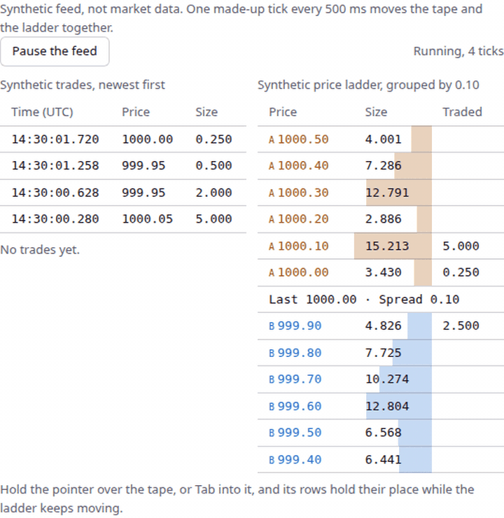

# Matchstick Primitives

Free building blocks for trading screens, fed by Matchstick replay or by your own data.



- Try it live: https://ui.matchstick.trading/docs/live (made-up data, no sign-in).
- Issues are open for feedback: https://github.com/matchstick-trading/primitives/issues
- Licence: Apache-2.0 (see `LICENSE`).

Headless, keyboard-first React parts for trading screens, with a plain-TypeScript core under them. Charts, studies,
drawings, a volume profile, a replay transport and scrubber, a cursor, a depth profile, a diff table, a symbol search,
a receipt and a notice. Developer preview, version 0.0.10: names and parts can change.

Every demo and example uses made-up (synthetic) data. No market data ships in this package, and the parts place no
orders: there is no order entry, account or trading feature here.

## Status

- Developer preview. Names, parts and data shapes can change, and there is no promise of updates or support.
- Install: `npm install @matchstick-trading/primitives` (React 18 or 19 is a peer dependency).
- Licence: Apache-2.0. The source in `src/` ships with the package and you may use it under the terms in `LICENSE`.
  The licence covers this package only, not Matchstick Replay or any other Matchstick product.

## First chart

The parts use React state and context. The package already starts its interactive modules with `'use client'`, so you can import and compose them (`Chart.Root`, `Chart.Plot`, ...) in a Next.js App Router server component; props must be serialisable (pass plain data, and put event handlers and render functions in your own client component).

The snippets below use synthetic data.

```tsx
import { Chart } from '@matchstick-trading/primitives';
import '@matchstick-trading/primitives/tokens.css';

// Made-up one-minute bars. Replace with your own list of { timestamp (ms), open, high, low, close, volume }.
export const bars = Array.from({ length: 60 }, (_, i) => {
  const base = 100 + Math.sin(i / 6) * 2 + i * 0.03;
  return { timestamp: Date.UTC(2026, 0, 7, 19, i), open: base, high: base + 0.4, low: base - 0.4, close: base + (i % 2 ? 0.2 : -0.2), volume: 100 + (i % 7) * 20 };
});

export function FirstChart() {
  return (
    <Chart.Root bars={bars} synthetic aria-label="Synthetic one-minute bars">
      <Chart.Plot>
        <Chart.Grid />
        <Chart.Volume />
        <Chart.Candles style="candle" />
        <Chart.PriceAxis />
        <Chart.TimeAxis />
        <Chart.Crosshair />
      </Chart.Plot>
      <Chart.Readout />
    </Chart.Root>
  );
}
```

In a TypeScript project, importing `tokens.css` needs the bundler's asset types (`"types": ["vite/client"]` in
`tsconfig.json` for Vite), or `tsc` reports TS2882. The chart is 420 px tall by default and as wide as its container;
set `height` (and optionally `width`) on `Chart.Root` to change that, rather than sizing a wrapper around it.

The chart draws SVG and leaves stroke and fill to you, so add this once (it styles `data-part` and `data-change`, not class names):

```css
[data-part='grid'] line { stroke: #8884; }
[data-part='candles'] line { stroke: currentColor; }
[data-part='candles'] rect { fill: currentColor; }
[data-part='candles'] [data-change='up'] { color: var(--mt-up); }
[data-part='candles'] [data-change='down'] { color: var(--mt-down); }
[data-part='candles'] [data-change='flat'] { color: var(--mt-flat); }
[data-part='candles'] [data-change='up'] rect { fill: none; stroke: currentColor; } /* up bodies hollow, down solid: direction never rests on colour alone */
[data-part='volume'] [data-change='up'] { fill: color-mix(in srgb, var(--mt-up) 45%, transparent); }
[data-part='volume'] [data-change='down'], [data-part='volume'] [data-change='flat'] { fill: color-mix(in srgb, var(--mt-down) 45%, transparent); }
[data-part='price-axis'] text, [data-part='time-axis'] text { fill: currentColor; font: 11px var(--mt-font-numeric); }
[data-part='crosshair'] line { stroke: currentColor; stroke-dasharray: 3 3; }
```

The crosshair's price label (`[data-part='crosshair-price']`) already takes the text colour at 11px from `tokens.css`; override it the same way as the axis labels if you want.

### Add a scrubber

`Scrubber` is a track you position with CSS: it has no size of its own, so give the track `position: relative` and a
height, or it is invisible. Marks and the thumb are placed with `left` as a percentage of the track.

```css
[data-part='scrubber-track'] { position: relative; height: 24px; background: #8882; }
[data-part='scrubber-mark'] { position: absolute; top: 0; bottom: 0; background: #ff980055; }
[data-part='scrubber-thumb'] { position: absolute; top: 0; width: 12px; height: 24px; margin-left: -6px; background: currentColor; }
```

`fraction` is 0 to 1 along the track; the host maps it to whatever it scrubs (for example a bar index) and decides what
one `onStep` event means.

```tsx
import { useState } from 'react';
import { Scrubber } from '@matchstick-trading/primitives';

export function ReplayScrubber() {
  const [fraction, setFraction] = useState(0.3);
  return (
    <Scrubber.Root
      fraction={fraction}
      onCommit={setFraction} // once, on release
      onStep={(direction) => setFraction((f) => Math.min(1, Math.max(0, f + direction * 0.05)))} // arrow keys: -1 or 1
    >
      <Scrubber.Track>
        <Scrubber.Mark at={0.5} span={0.1} label="Gap" kind="gap" />
        <Scrubber.Thumb label="Replay position" />
      </Scrubber.Track>
    </Scrubber.Root>
  );
}
```

### Add a volume profile

`VolumeProfile.Histogram` goes inside `Chart.Plot` and draws SVG with no fill, so it shows as black blocks until you style it. Put it before the candles so they stay on top:

```css
[data-part='profile-row'] [data-change='up'] { fill: color-mix(in srgb, var(--mt-up) 35%, transparent); }
[data-part='profile-row'] [data-change='down'] { fill: color-mix(in srgb, var(--mt-down) 35%, transparent); }
[data-part='profile-row'][data-poc] rect { stroke: currentColor; }
[data-part='poc'], [data-part='vah'], [data-part='val'] { stroke: currentColor; stroke-dasharray: 2 3; }
```

`VolumeProfile.Table` is the same profile as text and also needs a `Chart.Root` above it: place it inside `Chart.Root` after `Chart.Plot` (it is an HTML table, not SVG). Outside `Chart.Root` it throws "Chart VolumeProfile.Table needs a Chart.Root above it."

### Add a depth profile

`DepthProfile` draws SVG with no fill or stroke, like the chart. Give it `levels` (each `{ side: 'bid' | 'ask', price, cumulative }`, with price and cumulative as strings) and add this once:

```css
[data-part='depth-bids'] { fill: #1f77b455; stroke: #1f77b4; }
[data-part='depth-asks'] { fill: #ff7f0e55; stroke: #ff7f0e; }
[data-part='depth-axis'] text { fill: currentColor; font: 11px var(--mt-font-numeric); }
[data-part='depth-crosshair'] line { stroke: currentColor; stroke-dasharray: 3 3; }
[data-part='depth-crosshair'] circle { fill: currentColor; }
figure table td, figure table th { padding: 0 0.75rem 0 0; text-align: left; } /* the depth table's cells */
```

Side is carried by the table and the readout words as well as by colour.

`DepthProfile` is a set of parts, not one component, so build it from them:

```tsx
import { DepthProfile, type DepthLevel } from '@matchstick-trading/primitives';

// Best price first on each side: the best bid is the highest, the best ask the lowest.
const levels: DepthLevel[] = [
  { side: 'bid', price: '99.9', cumulative: '5' },
  { side: 'bid', price: '99.8', cumulative: '12' },
  { side: 'ask', price: '100.1', cumulative: '7' },
  { side: 'ask', price: '100.2', cumulative: '12' },
];

export function Depth() {
  return (
    <DepthProfile.Root levels={levels}>
      <DepthProfile.Plot>
        <DepthProfile.Bids />
        <DepthProfile.Asks />
        <DepthProfile.Axis />
        <DepthProfile.Crosshair />
      </DepthProfile.Plot>
      <DepthProfile.Readout />
      <DepthProfile.Table />
    </DepthProfile.Root>
  );
}
```

Typing the list as `DepthLevel[]` keeps `side` from widening to `string`. Arrow keys on the plot move the crosshair.

### Add replay controls and a notice

`Transport` buttons render empty: put the label (or an icon with a name) inside each one. The host owns the handlers.

```tsx
import { useState } from 'react';
import { Transport, Notice } from '@matchstick-trading/primitives';

export function Controls() {
  const [playing, setPlaying] = useState(false);
  const [speed, setSpeed] = useState(1);
  const [bar, setBar] = useState(12);
  return (
    <>
      <Transport.Root playing={playing} aria-label="Replay controls">
        <Transport.Group>
          <Transport.Start onClick={() => setBar(0)}>Start</Transport.Start>
          <Transport.Previous onClick={() => setBar((b) => Math.max(0, b - 1))}>Back</Transport.Previous>
          <Transport.Play onClick={() => setPlaying((p) => !p)}>{playing ? 'Pause' : 'Play'}</Transport.Play>
          <Transport.Next onClick={() => setBar((b) => b + 1)}>Forward</Transport.Next>
          <Transport.End onClick={() => setBar(59)}>End</Transport.End>
        </Transport.Group>
        <Transport.Speed speed={speed} options={[0.5, 1, 2, 4]} onSpeedChange={setSpeed} format={(x) => `${x}x`} />
        <Transport.Readout>Bar {bar + 1} of 60</Transport.Readout>
      </Transport.Root>
      <Notice kind="gap" role="status">Two minutes of data are missing here.</Notice>
    </>
  );
}
```

`Transport` and `Notice` have almost no look of their own. `Notice` sets `data-kind` (`gap`, `stale`, `truncated`, `unsupported`, `rights`, `info`, `ok`, `error`) and nothing styles it, so every kind looks the same until you add this kind of rule:

```css
[data-kind='error'] { color: #b00020; }
[data-kind='gap'], [data-kind='stale'], [data-kind='truncated'] { color: #8a5a00; }
[data-kind='ok'] { color: #1b6e3c; }
nav[aria-label] > * + * { margin-inline-start: 0.5rem; } /* space the transport controls */
```

### Give a series a clock (`points`)

A series is a list of `{ t, kind, v? }` points, not a bare array: `t` is an ISO-8601 UTC string, `kind` is `value`, `missing`, `market-closed`, `not-applicable`, `halted` or `unknown`, and a `value` point has a finite `v` (zero is a value; NaN and infinities are refused). `Panels.Root` series and `Study.Line` take `points` and line them up with the bars by time, so a gap in the data is a gap on the chart, named in the list. `values` (an array with one number or null per bar) still works for now and will be removed in a later version; `pointsFromValues(bars, values)` converts one (it takes the bars, or their times in ms; a null or NaN becomes `not-applicable` unless you pass another gap kind).

```ts
import { csvAdapter, toSeriesSet, validateSeriesSet, report } from '@matchstick-trading/primitives/core';

const read = csvAdapter.read(text, { utcOffsetMinutes: 0 }); // bars, extra numeric columns as series, errors, plain-language notes
const set = toSeriesSet(read);
const problems = validateSeriesSet(set);                     // every issue in one pass
const findings = report(set);                                // feed-stopped, no-point, gap-kind-differs, unclassified
```

An empty or `NA` cell in an extra column becomes `unknown`, never zero. A time with no zone is read at the fixed offset you give (`utcOffsetMinutes`, UTC when you give none) and the notes say so (they say nothing when every time carries a zone). A column with a cell that is not a number or a no-value word is left out of the series and named in the notes. `Panels.List` says how many bars a series has no value on and why, and where it stops; there is no time-zone database. Each series entry in `Panels.Root` also takes `range: [low, high]` to fix its band's scale (a value outside it is cut off at the band's edge), `levels` for reference lines, and `style: 'histogram'`. They are fields of the series, not of the `panels` definitions.

### Add a study (an indicator line)

A study is two things: a function from `@matchstick-trading/primitives/core` that turns bars into numbers (`ema`, `sma`, `wma`, `bollinger`, `vwap`, `rsi`, `atr`), and a part that draws the numbers (`Study.Line` for a line, `Study.Band` for a band between two series). `Study.Root` goes inside `Chart.Root` and wraps both the `Chart.Plot` that holds the lines and the `Study.Legend`, which lists the names and values and sits outside the SVG:

Two things the types will not say until the first build. `vwap`'s `bands` is a list of multipliers, not a count or a flag: `vwap(bars, { bands: [1] })` gives one band (`.bands[0].upper` and `.lower`), `[1, 2]` gives two. `studyRange` returns one `[low, high]` span, but `Chart.Root`'s `include` returns a list of spans, so wrap it: `include={(visible) => [studyRange(visible, band.upper, band.lower)]}` (keep the callback stable with `useCallback`).

```tsx
import { Chart, Study, ema, pointsFromValues } from '@matchstick-trading/primitives';

import { bars } from './FirstChart'; // the `bars` list exported by the first chart above, saved as FirstChart.tsx
const ema10 = pointsFromValues(bars, ema(bars, 10)); // compute once, outside the component, or in useMemo

export function ChartWithEma() {
  return (
    <Chart.Root bars={bars} synthetic aria-label="Synthetic bars with an EMA">
      <Study.Root>
        <Study.Legend />
        <Chart.Plot>
          <Chart.Candles />
          <Study.Line points={ema10} name="EMA 10" />
          <Chart.PriceAxis />
          <Chart.TimeAxis />
        </Chart.Plot>
      </Study.Root>
    </Chart.Root>
  );
}
```

Like the candles, the study parts draw SVG with no stroke or fill, so add this too:

```css
[data-part='study-line'] { stroke: #7a5cff; stroke-width: 1.25; fill: none; }
[data-part='study-band'] { fill: #7a5cff22; stroke: none; }
[data-part='study-legend'] { list-style: none; margin: 0; padding: 0; font: 12px var(--mt-font-numeric); }
```

`rsi` is not a price overlay (its values are 0 to 100), so do not draw it on the price pane; this version has no separate indicator pane.

### Add drawings

Drawings need a `Drawings.Root` around the chart and the toolbar, and a `Drawings.Layer` inside `Chart.Plot`. The Layer is what turns a click on
the chart into a drawing: without it a pressed tool does nothing. On touch, a vertical swipe on the chart scrolls the page while no tool is armed and nothing is selected (a tap on a drawing selects it); once a tool is armed or a drawing is selected the plot keeps the gesture (`touch-action: none`) so drawing and dragging work, so scroll the page from outside the chart then.

```tsx
import { Chart, Drawings } from '@matchstick-trading/primitives';
import '@matchstick-trading/primitives/tokens.css';
import { bars } from './FirstChart';

export function DrawingChart() {
  return (
    <Drawings.Root>
      <Drawings.Toolbar tools={['trend-line', 'horizontal-line', 'rectangle']} />
      <Chart.Root bars={bars} synthetic aria-label="Synthetic one-minute bars">
        <Chart.Plot>
          <Chart.Grid />
          <Chart.Candles style="candle" />
          <Chart.PriceAxis />
          <Chart.TimeAxis />
          <Chart.Crosshair />
          <Drawings.Layer />
        </Chart.Plot>
      </Chart.Root>
      <Drawings.Undo />
      <Drawings.List />
    </Drawings.Root>
  );
}
```

Add the chart CSS from "First chart". `tokens.css` strokes the drawings in `currentColor` with no fill, so they show in the text colour; set
`color` on `[data-part='drawing']` to change it. Press a tool, then click twice on the chart (or press Enter twice with the chart focused).

The parts draw no styling of their own. The chart, study, depth and scrubber parts set `data-part` and state attributes
(`data-change`, `data-state`, `data-selected`, `data-synthetic`), and `tokens.css` plus your own CSS read those; the
replay controls take a `className`. Colours are colour-blind safe by
default, and direction is also carried by a mark, never by colour alone.

### Select the series and studies

One thing is selected on a chart at a time: a drawing, the bar series or a study. `Selection.Root` holds that one value, `{ kind: 'drawing' | 'series' | 'study', id }` or `null`, and says each change in a polite live region. It is opt-in: without a `Selection.Root` above them, `Drawings` and `Study` behave exactly as before.

```tsx
import { useMemo, useState } from 'react';
import { Chart, Selection, Series, Study, ema, pointsFromValues, type ChartSelection } from '@matchstick-trading/primitives';
import { bars } from './FirstChart';

export function SelectableChart() {
  const [selection, setSelection] = useState<ChartSelection>(null);
  const ema10 = useMemo(() => pointsFromValues(bars, ema(bars, 10)), []);
  const [interval, setInterval] = useState('1m');
  return (
    <Selection.Root selection={selection} onSelectionChange={setSelection}>
      <Series.Root id="main" label="Synthetic bars">
        <Series.Select />
        <Chart.Root bars={bars} synthetic aria-label="Synthetic bars">
          <Study.Root>
            <Study.Legend />
            <Chart.Plot>
              <Chart.Candles />
              <Study.Line id="ema10" points={ema10} name="EMA 10" />
              <Selection.Layer />
            </Chart.Plot>
          </Study.Root>
        </Chart.Root>
        <Series.Options>
          {/* The options are yours: the parts ship no fields. */}
          <label>Interval <select value={interval} onChange={(event) => setInterval(event.target.value)}><option>1m</option><option>5m</option></select></label>
        </Series.Options>
      </Series.Root>
    </Selection.Root>
  );
}
```

| Part | What it does |
|---|---|
| `Selection.Root` | Holds the selection (`selection` and `onSelectionChange` to control it) and announces each change in a visually hidden `data-part='selection-status'` live region. |
| `Selection.Layer` | Goes inside `Chart.Plot`, after `Drawings.Layer` if there is one. Reads taps and Escape on the chart. Draws nothing. |
| `Series.Root` | `{ id, label }`. Says a bar series exists, so a tap on clear chart can select it. Without one, a tap on clear chart selects nothing. |
| `Series.Select` | A button, `aria-pressed`, named by the series label (or `label` or children). The keyboard and touch way to do what a tap on clear chart does; press again to put it away. |
| `Series.Options` | `data-part='series-options'`, `role='group'` with an `aria-label` (default: the label and "options"). Renders its children only while the series is selected. |
| `Study.Line`, `Study.Band` with `id` | Selectable with a `Selection.Root` above: a tap on the line or band (a transparent `data-part='study-hit'` stroke 44 px wide, the `--mt-touch-target` size, so a finger can hit it) and a `data-part='study-select'` button in each `Study.Legend` item. Give the study a `name`: the button is named by it. |

The rules, one tap or key, one effect:

- Tap on a drawing selects it. Tap on a study line or band that has an `id` selects that study.
- Tap on clear chart with something selected only puts the selection away.
- Tap on clear chart with nothing selected selects the series, when a `Series.Root` is mounted. With none, nothing happens, as before.
- Escape (chart focused) clears whatever is selected. A half-placed drawing or an armed drawing tool takes the first Escape.
- A drag is the chart panning, and never selects or deselects. A second finger (a pinch) does not count as a tap.
- Inside a `Selection.Root`, `Drawings.Root` reads and writes the same selection (a selected drawing is `{ kind: 'drawing' }`) and its own `selected` prop is ignored; `onSelectedChange` still fires.

The selected series, study line, study band and legend item carry `data-state='selected'` (the candles group for the series). `tokens.css` draws the selected series and study with a heavier stroke, so the state is not colour alone; `aria-pressed` and the live region say it in words. Series options are yours to fill: put your own controls in `Series.Options` (an interval list, an instrument picker) and decide what a change means. Show the panel where it does not push the chart down, or a second tap lands somewhere else.

The selection is not tied to a symbol or a list. Drawing ids are only unique within one list (`nextDrawingId` starts every list at `drawing-1`), so after a symbol
switch a `{ kind: 'drawing', id }` selection can point at the other list's drawing with the same id. Clear it yourself when you swap `drawings`
(`setSelection(null)`), the same way you replace the list. The same goes for a `Series.Root` or study `id` that changes with the symbol.

Study `id`s are unique on a chart: two studies with the same id are selected together. `Series.Options` and `Series.Select` throw if there is no `Series.Root` above them, and `Series.Root` throws without a `Selection.Root`. The pure rules (`selectionAfterTap`, `selectionAfterClearTap`, `selectionAfterEscape`, `describeSelection`) are in `@matchstick-trading/primitives/core`.

## Panels and several series

A chart can have more than one band, each with its own price scale, on one shared time axis. The chart's own bars and volume stay in the first band, `main`. Other series (a value per bar, `null` for none, like a study) are given to `Panels.Root`, which places each one in a band and lets a person move it to another. It is opt-in: without a `Panels.Root`, the chart draws exactly as it did.

```tsx
import { useMemo } from 'react';
import { Chart, Panels, Selection, ema, pointsFromValues, rsi } from '@matchstick-trading/primitives';
import { bars } from './FirstChart';

const panels = [{ id: 'rsi', label: 'RSI panel' }];

export function PanelChart() {
  const series = useMemo(() => [
    { id: 'ema50', label: 'EMA 50', points: pointsFromValues(bars, ema(bars, 50)) }, // starts in main, on the price scale
    { id: 'rsi14', label: 'RSI 14', points: pointsFromValues(bars, rsi(bars, 14)), panel: 'rsi' }, // starts in a band of its own
  ], []);
  return (
    <Selection.Root>
      <Panels.Root series={series} panels={panels}>
        <Chart.Root bars={bars} height={520} synthetic aria-label="Synthetic bars with an EMA and an RSI panel">
          <Panels.List />
          <Chart.Plot>
            <Chart.Grid />
            <Chart.Candles />
            <Panels.Layer />
            <Chart.PriceAxis />
            <Chart.TimeAxis />
            <Selection.Layer />
          </Chart.Plot>
        </Chart.Root>
        <Panels.Move />
      </Panels.Root>
    </Selection.Root>
  );
}
```

| Part | What it does |
|---|---|
| `Panels.Root` | Holds the layout (controlled with `layout` and `onLayoutChange`, or its own) and says each move in a polite live region (`data-part='panels-status'`). Takes `series` and, optionally, `panels` (`{ id, label, weight }`) for the bands the series start in. |
| `Panels.Layer` | Inside `Chart.Plot`, after the chart's own parts. Draws each band (`data-part='panel'`, `data-panel`): a divider, a grid, price labels, a label and a crosshair line for every band but `main`, and the series (`data-part='panel-series'`, `data-series`). A series in `main` uses the chart's price scale and keeps itself in view. |
| `Panels.List` | Outside the SVG, inside `Chart.Root`. Each series, its band and its value at the crosshair bar (the last bar in view without one). With a `Selection.Root`, each row has a button that selects the series (`aria-pressed`). |
| `Panels.Move` | Shows while a series of the Root is selected (or for `seriesId`): buttons for where it can go, relative to where it is (`Move up to Main`, `Move down to RSI panel`, `Move to a new panel above`, `Move to a new panel below`). No drag is needed. After a move the focus goes to the group (`data-part='panel-move'`). |

A tap on a series line selects it (`{ kind: 'series', id }`, one selection at a time, shown with a heavier stroke and `data-state='selected'`). A tap on clear chart below the first band selects nothing. A band is never shorter than 40, the split is fixed (`main` gets three shares and every other band one), and the time labels sit under the last band, so give `Chart.Root` enough `height`. A band left with no series is removed, and `main` is always first. With the Root's own layout, a series added later starts in the band it names and one taken away leaves its band (an empty band goes); a placement a person made is kept. With a controlled `layout` (`PanelLayout`: `{ panels: { id, label, weight? }[], placement: Record<seriesId, panelId> }`; `main` is always first and is added if you leave it out, and its label is not drawn on the chart), keeping it in step with `series` is yours (`reconcileLayout` is in the core), and a move is announced only after the layout you give back puts the series there. With a `layout`, a series' `panel` and the `panels` prop are not read; `PanelLayout` and the rules are exported from the package root and from `/core`. The layout handed to `onLayoutChange` always lists `main` first, and a new band gets the id `panel-N` and the label `Panel N` (a new band below `main` goes directly under it); a band that was emptied and made again is a new band with a new name. Series with very different ranges in one band share its scale, so the smaller one flattens. To use panels in full screen, put `Panels.Root` and the chart in a child component of the `Fullscreen.Frame`, where `useFullscreen` can set the height. The panel styles (`panel-series`, divider, grid, axis, label) are in `tokens.css`, which `FirstChart` imports. Only the series you give can move: the chart's bars, volume and drawings stay in `main`, and the price range controls (`Chart.Reset`, `Chart.Autoscale`, a drag on the price labels) belong to `main`. Dragging a series between bands is not built in; the Move buttons are the way. A series that is no longer given is deselected. The pure rules (`panelBands`, `moveTargets`, `moveSeries`, `normalizeLayout`) are in `@matchstick-trading/primitives/core`.

## The parts

| Import | What it is |
|---|---|
| `Chart` | Root, Plot, Grid, Volume, Candles (candle, hollow, ohlc, line, area, heikin-ashi), PriceAxis, TimeAxis, Crosshair, Readout, Reset, Autoscale. Pan, zoom and axis keys built in. |
| `Study` | EMA, SMA, WMA, Bollinger, RSI, ATR and VWAP lines and bands, and a legend. |
| `Selection`, `Series` | One selection (drawing, series or study) for the chart: `Selection.Root`, `Selection.Layer`, `Series.Root`, `Series.Select`, `Series.Options`, and an `id` on `Study.Line` and `Study.Band`. |
| `Panels` | Several series in bands with their own price scales, and a menu to move a series between bands: `Panels.Root`, `Panels.Layer`, `Panels.List`, `Panels.Move`. |
| `VolumeProfile` | Histogram and options over the visible bars. |
| `Drawings` | `Root`, `Layer` (the drawing surface, inside `Chart.Plot`), `Toolbar`, `List`, `Remove`, `Undo`, `Lock`, `Edit`. Trend line, ray, extended line, horizontal and vertical lines, rectangle, Fibonacci retracement, price range, text note; Toolbar, List, Remove with undo, Lock, Edit (typed price, time, bar and attach mode). Enter places a point at the crosshair. |
| `Toolbar`, `Menu`, `Submenu` | A toolbar that is one tab stop (arrow keys, Home, End, Escape back to the chart); a button that opens a menu; a menu item that opens another. Tap or key, never hover. |
| `Fullscreen` | `Frame` (a wrapper; `data-fullscreen` while expanded) and `Toggle` (a button with `aria-pressed`). The browser's full screen where it has one, a full-page fallback where it does not. |
| `Transport`, `Scrubber`, `Cursor` | Replay controls, a scrub bar and a cursor you can step through events. |
| `DepthProfile`, `DiffTable`, `Tape`, `Ladder`, `Receipt` | A depth view, a sortable table that shows what changed, the latest trades newest first (rows hold still while you read), a price ladder with size bars and a spread row, and a verifiable receipt. |
| `SymbolSearch`, `CsvDrop` | A search over a list you supply, and a drop zone that reads a CSV of bars. |
| `Notice` | A status message with a kind. |

Types are in `dist/index.d.ts` with the doc comments for every part and prop.

### Every control has a name

A button, menu item or tool names its action in words, even when an icon is all that shows. The words are the visible text, or,
with `hideLabel`, the `aria-label`. `icon` is a slot you fill with your own graphic: it is hidden from assistive technology
(`aria-hidden`, `data-part="icon"`), and **no icons ship in this package**. A control with neither words nor a label has no name and
logs a warning to the console. This holds for `Toolbar.Button`, `Menu.Trigger`, `Menu.Item`, `Menu.RadioItem`, `Submenu.Trigger`,
the drawing tools and `Drawings.Lock`, `Remove`, `Undo`, `Edit`, and `Chart.Reset` and `Chart.Autoscale`.

```tsx
import { Chart, Drawings, Toolbar } from '@matchstick-trading/primitives';

// Your own icons; here a plain character stands in for one.
const ICONS = { 'trend-line': '/', 'horizontal-line': '-' };

export function Controls() {
  return (
    <Drawings.Root>
      {/* Only the icons show; each button is still named "Trend line", "Horizontal line" and so on. */}
      <Drawings.Toolbar tools={['trend-line', 'horizontal-line']} icon={ICONS} hideLabels />
      {/* A rename: labels change the words and the accessible name. */}
      <Drawings.Toolbar aria-label="Lines" tools={['trend-line']} labels={{ 'trend-line': 'Diagonal' }} />
      <Drawings.Lock icon="L" label="Lock drawing" hideLabel />
      <Toolbar.Root aria-label="View">
        <Toolbar.Button icon="+" label="Zoom in" hideLabel />
      </Toolbar.Root>
      <Chart.Root bars={[]}>
        <Chart.Reset icon="R" label="Reset view" hideLabel />
      </Chart.Root>
    </Drawings.Root>
  );
}
```

### Toolbar, Menu and Submenu

`Toolbar.Root` is `role="toolbar"` with one tab stop: Left and Right (Up and Down with `orientation="vertical"`) move between its
items, Home and End jump, Escape sends focus to `returnFocusTo` (a ref or a function that returns the element). Its items are
`Toolbar.Button` (`pressed` makes it a toggle) and `Menu.Trigger`. A `Menu` is a trigger plus a `Menu.List` of `Menu.Item` and
`Menu.RadioItem`; a `Submenu` goes inside a list. Everything opens by tap or click; nothing opens on hover. Inside a list: ArrowUp,
ArrowDown, Home, End, typeahead, Enter or Space to pick, Escape to close and return to the trigger, ArrowRight and ArrowLeft to open and
close a submenu. On a coarse pointer every button and item is at least `--mt-touch-target` (44px). The list is absolutely positioned
against the menu, so an ancestor that clips overflow will clip it.

### Full screen

`Fullscreen.Frame` is a wrapper div: put the chart, its controls and the `Fullscreen.Toggle` inside it. The toggle expands the frame to the whole
screen and back. It works everywhere: where the browser has the Fullscreen API (desktop browsers, iPad Safari through its `webkit` prefix) the
frame goes full screen natively; where it does not (iPhone Safari), or the browser refuses, the frame instead fills the page itself (fixed over
everything, inside the safe areas, painted with `--mt-fullscreen-bg`, text in `--mt-fullscreen-fg`: light by default, dark under `data-theme='light'`), the page behind it becomes `inert` so focus and taps stay in the frame, and
the page stops scrolling. All of that is put back when you leave, even if the frame unmounts while expanded. Nothing is hidden when full screen is
unsupported. Leaving through the browser's own UI is followed, and focus goes back to the toggle.

```tsx
import { Chart, Fullscreen, useFullscreen } from '@matchstick-trading/primitives';
import { bars } from './FirstChart'; // the `bars` list exported by the first chart above, saved as FirstChart.tsx

function TallChart() {
  const { fullscreen } = useFullscreen(); // inside the Frame: lets the chart use the extra height
  return (
    <Chart.Root bars={bars} height={fullscreen ? 640 : 420}>
      <Chart.Plot>
        <Chart.Candles style="candle" />
        <Chart.Crosshair />
      </Chart.Plot>
      <Chart.Readout />
    </Chart.Root>
  );
}

export function ChartWithFullScreen() {
  return (
    <Fullscreen.Frame>
      <Fullscreen.Toggle /> {/* "Full screen" / "Exit full screen"; label and exitLabel rename, icon and hideLabel as on any button */}
      <TallChart />
    </Fullscreen.Frame>
  );
}
```

| `data-part` | What it is |
|---|---|
| `fullscreen-frame` | The wrapper. `data-fullscreen` is present while expanded; `data-mode` is `native` or `fallback`. |
| `fullscreen-toggle` | The button. `aria-pressed` is true while expanded; `data-touch-target` gives it `--mt-touch-target` (44px) on a coarse pointer. |
| `fullscreen-status` | A visually hidden live region: "Full screen" on entering, "Exited full screen" on leaving. |

`Fullscreen.Frame` keeps its own state; pass `fullscreen` and `onFullscreenChange` to control it. A browser may refuse native full screen unless a
tap or key asked for it, so a `fullscreen` prop set from code alone can end up in the in-page fallback. Put the toggle inside the frame: the page
behind an in-page frame is inert, and a toggle outside it could not be reached. The in-page fallback is `position: fixed`, so an ancestor with a
`transform`, `filter` or `contain` would trap it; keep the frame out of one.

Escape leaves full screen, in this order. A part that handles Escape itself goes first: an open menu closes, the `Drawings.Edit` form closes,
the toolbar sends focus to its `returnFocusTo`. Then, with a drawing tool armed or a drawing half placed, the first Escape disarms or cancels it.
Then, with focus on the chart, Escape clears what the chart has marked: the crosshair bar, or a selection of any kind (a drawing, the series, a
study). With none of those, or with focus elsewhere in the frame, it leaves full screen. The frame reads these from the parts' own attributes
(`data-part='crosshair'`, `data-selected`, `data-state='selected'`, `data-draft`, `aria-pressed` on the armed tool), so a host that restyles the
parts keeps them. Native full screen has the browser's own Escape too.

### Drawing from the keyboard

With a tool pressed and the chart focused:

| Key | What it does |
|---|---|
| Arrow keys, Home, End | Move the crosshair bar by bar; a half-placed drawing follows it. |
| Enter | Place a point at the crosshair: the crosshair bar, at the crosshair price (from the keyboard, that bar's close). A one-point tool is done; a two-point tool takes a second Enter at a different place. |
| Escape | Drop a half-placed drawing, then put the tool away. |
| Ctrl or Cmd + Z | Put back the last removal while `Drawings.Undo` still offers it. |

Each step is spoken in the polite live region of `Drawings.Undo`, in words: "Trend line: first point at 100.40, 19:03." and "Trend line:
second point at 101.20, 19:07. Added Trend line from 100.40 at 19:03 to 101.20 at 19:07." The same region says "Updated ..." after
`Drawings.Edit` applies. After the last row of `Drawings.List` is removed, focus goes to the Undo button when it is showing, else to the
empty list, so it never falls to the top of the page.

On a coarse pointer every drawing control is at least `--mt-touch-target` (44px) in both directions: `Drawings.Undo`, `Drawings.Remove`, `Drawings.Lock`,
the `Drawings.Edit` toggle with its inputs, Apply and Cancel, and the three buttons in each `Drawings.List` row. Opening the Edit form scrolls it into view
(no smooth scroll under `prefers-reduced-motion`). A pending Undo is dropped when the host hands `drawings` back as a list the Root did not make
(for example a new empty array after a symbol switch); a copy of the same drawings in the same order keeps it. The copy must hold the same drawing objects: clones (immer, `structuredClone`, a server round-trip)
and a derived empty list (`drawings.filter(...)` after the last one is removed) count as a different list, so Undo is not offered. That trade is deliberate: it
cannot tell an emptied list from a switch to a symbol with no drawings, and a missing Undo is safer than a drawing restored onto the wrong symbol.

## The core, without React

`@matchstick-trading/primitives/core` is plain TypeScript with no imports outside itself: chart geometry and scales,
the studies (`ema`, `sma`, `rsi`, `atr`, `bollinger`, `vwap`), the volume profile, the drawing model, the CSV reader
(`parseBarsCsv`), the key maps and the chart's pointer and wheel gestures (`reduceChartGesture`, a pure reducer from an event to a viewport or price-range change). Use it from any framework or from Node.

## Your own data

Give `Chart.Root` a list of bars (a bar with a missing or non-finite time or price is left out rather than drawn, so filter such bars yourself before computing a study, or its values will not line up), or read a CSV with `parseBarsCsv` (or the `CsvDrop` part) and pass the result. Data
from a third party stays theirs and is not advice. Do not put real market data into anything you share.

## Tokens

Import `@matchstick-trading/primitives/tokens.css` once and override any custom property on a parent element. Every token:

- Layout and type: `--mt-touch-target` (44px), `--mt-font-numeric`.
- Surface: `--mt-surface`, the background the colour tokens are tuned for. The parts do not paint it. While a `Fullscreen.Frame` is expanded it paints `--mt-fullscreen-bg` (the surface by default) and sets its text colour to `--mt-fullscreen-fg` (`#e8eaef`, or `#14141c` under `data-theme='light'`), so axis labels, the readout and your own text stay readable.
- Colour: `--mt-bid`, `--mt-ask`, `--mt-up`, `--mt-down`, `--mt-flat`, `--mt-warn`, `--mt-error`, `--mt-destructive`, `--mt-synthetic`, `--mt-cursor-a`, `--mt-cursor-b`, `--mt-focus`.
- Defaults and where they come from: the dark values follow the Matchstick design tokens, written into `src/tokens.css`. Changed from 0.0.6: `--mt-focus` is pink `#ff2a85` (was amber `#ffc247`), `--mt-surface` is `#12151c` (was `#12121a`), `--mt-error` and `--mt-destructive` are `#ff6b6b` (were `#ff6b81`), `--mt-flat` is `#8c93a3` (was `#9090a0`), `--mt-fullscreen-fg` is `#e8eaef` (was `#e8e8f0`), and `--mt-font-numeric` is `"IBM Plex Mono", ui-monospace, SFMono-Regular, Menlo, monospace` (was `'SF Mono', 'Cascadia Code', 'Fira Code', monospace`; the package does not ship the font, so without it you get the system monospace). Bid and ask stay blue and orange. The light preset and `data-palette='classic'` are unchanged.
- Marks (text that carries meaning without colour): `--mt-mark-bid`, `--mt-mark-ask`, `--mt-mark-up`, `--mt-mark-down`, `--mt-mark-flat`, `--mt-mark-added`, `--mt-mark-removed`, `--mt-mark-modified`, `--mt-mark-gap`, `--mt-mark-stale`, `--mt-mark-truncated`, `--mt-mark-synthetic`.
- Drawing states: `--mt-drawing-width`, `--mt-drawing-width-active`, `--mt-drawing-width-selected`, `--mt-drawing-dash`, `--mt-drawing-dash-active`, `--mt-drawing-dash-selected`, `--mt-drawing-width-locked`, `--mt-drawing-dash-locked`, `--mt-drawing-handle-width`, `--mt-drawing-handle-width-dragging`.
- Other: `--mt-numeric-width` (set it on a column; see `numericWidth()`).

### Drawing state looks

A drawing is `data-state="passive"`, `"active"` (being drawn or moved) or `"selected"`, and may carry `data-locked`. The base token
(`--mt-drawing-width`, `--mt-drawing-dash`) is the passive state. The default is the look the docs site always had: passive is thin and
solid, active is thicker and dashed (`6 4`), selected is the thickest and solid. Change it without writing a selector:

```css
:root { --mt-drawing-dash-selected: 2 3; --mt-drawing-width-selected: 3.5; }   /* a dotted, heavy selection */
:root { --mt-drawing-dash-active: none; }                                      /* solid while moving */
:root { --mt-drawing-dash-locked: 8 3; }                                       /* locked drawings dashed; unset falls back to their state */
```

Width is an SVG stroke width, dash is a `stroke-dasharray` (`none` is solid). The rules sit in `tokens.css` behind `:where()`, so a rule of yours
always wins. The tokens apply to lines, rectangles and the level lines of a Fibonacci retracement. Colour is still yours: set `color` on `[data-part='drawing']` (the lines use `currentColor`).

### Light preset

`tokens.css` is tuned for a dark surface. For a light one, put `data-theme="light"` on any element over a white surface; nothing else changes:

```html
<div data-theme="light" style="background: var(--mt-surface)">
  <!-- Chart, DepthProfile, Notice, ... -->
</div>
```

`data-palette="classic"` has a light variant (green and red) when used on or inside the same element. The package does not follow
`prefers-color-scheme` on its own; to do that, set `data-theme` from your own media query or script. Contrast was computed with the WCAG 2 relative-luminance
formula: text-like tokens need 4.5:1, non-text marks (cursor edges) and the focus ring need 3:1.

| Token | Light | Dark | Light on #ffffff | Dark on #12151c | Minimum |
|---|---|---|---|---|---|
| `--mt-bid` | `#1f6fd1` | `#4aa3ff` | 4.94 | 6.94 | 4.5 |
| `--mt-ask` | `#a64f00` | `#ff9f43` | 5.62 | 8.95 | 4.5 |
| `--mt-up` | `#1f6fd1` | `#4aa3ff` | 4.94 | 6.94 | 4.5 |
| `--mt-down` | `#a64f00` | `#ff9f43` | 5.62 | 8.95 | 4.5 |
| `--mt-flat` | `#5f5f70` | `#8c93a3` | 6.25 | 5.93 | 4.5 |
| `--mt-warn` | `#8a5a00` | `#ffc247` | 5.93 | 11.36 | 4.5 |
| `--mt-error` | `#c0243f` | `#ff6b6b` | 5.89 | 6.58 | 4.5 |
| `--mt-destructive` | `#c0243f` | `#ff6b6b` | 5.89 | 6.58 | 4.5 |
| `--mt-synthetic` | `#7a3fd0` | `#b48cff` | 6.09 | 7.08 | 4.5 |
| `--mt-cursor-a` | `#1f6fd1` | `#4aa3ff` | 4.94 | 6.94 | 3 |
| `--mt-cursor-b` | `#a64f00` | `#ff9f43` | 5.62 | 8.95 | 3 |
| `--mt-focus` | `#a86400` | `#ff2a85` | 4.68 | 5.15 | 3 |
| classic `bid/up/cursor-a` | `#0a7a4f` | `#00c87a` | 5.37 | 8.30 | 4.5 |
| classic `ask/down/cursor-b` | `#c0243f` | `#ff4d6a` | 5.89 | 5.67 | 4.5 |

The colours that failed on white in 0.0.2 (synthetic 2.58, bid 2.63, ask 2.04, warn 1.61, error 2.74, flat 3.14, focus 1.61) now pass in the light preset.

## What is in this package

- `README.md`, `AGENTS.md`, `llms.txt`: this file, how an agent should use the package, and a short index.
- `dist/`: compiled JavaScript and `.d.ts` declarations for `.` and `./core`.
- `src/tokens.css`, imported as `@matchstick-trading/primitives/tokens.css`: the design tokens (`--mt-*`), including `--mt-touch-target`, the light preset and the drawing state tokens (see Tokens).
- `examples/`: small runnable files with synthetic data (`node examples/studies.mjs`).

The TypeScript source in `src/` (without its tests) ships too, under the same licence.

More: https://ui.matchstick.trading/docs/getting-started · supported scope and known limits:
https://ui.matchstick.trading/docs/supported · issues: https://github.com/matchstick-trading/primitives/issues
